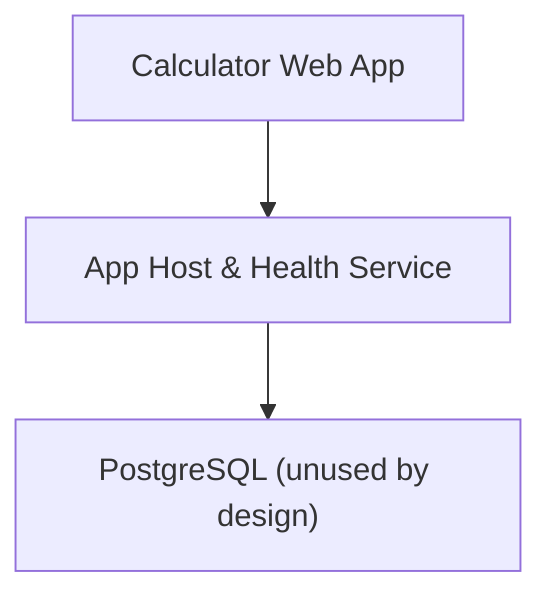
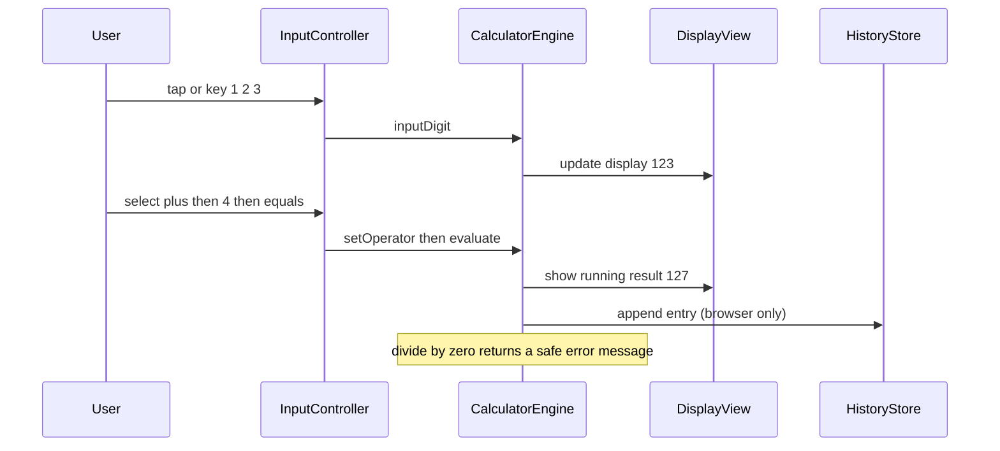
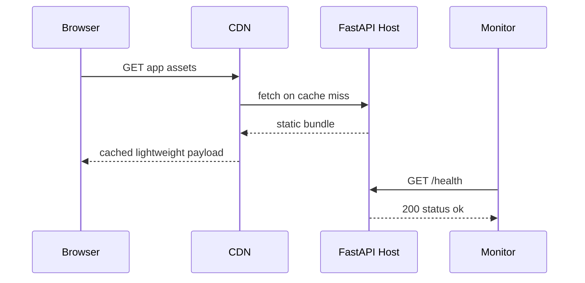
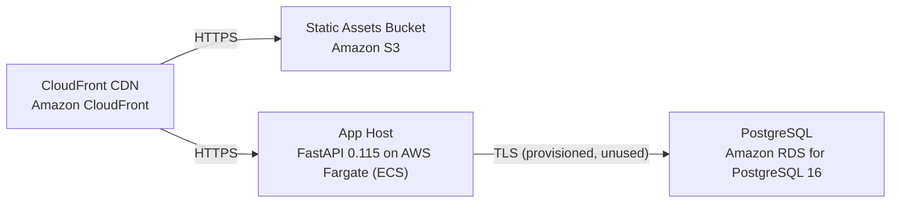

# Architecture

> Maintained by QuorQ AI SDLC. Text between `sdlc:auto` markers is regenerated; anything outside them is yours and is kept.

<!-- sdlc:auto:start narrative -->
## Overview

### ARCH-000 · draft

No architecture-phase input has been provided for this project.

Architecture phase has not started. The requirements phase names an approved technology stack (FastAPI, AWS, PostgreSQL, React) and asks for AWS Mumbai-region hosting, a CDN, and a health/status endpoint, but no architecture diagrams, component design, API contracts, data model, or infrastructure design have been produced yet.

**Related:** REQ-STACK, REQ-NFR-003

- ⚠ Architecture phase has not started -- no design documentation exists to verify how the approved stack will be assembled (e.g., FastAPI health endpoint contract, AWS region/CDN topology, React app structure).
<!-- sdlc:auto:end narrative -->

<!-- sdlc:auto:start building-blocks -->
## Building Block View

| ID | Name | Technology | Responsibility | Depends on |
|---|---|---|---|---|
| frontend | Calculator Web App | React 19 | Renders the responsive, accessible calculator UI, handles all digit/operator/percentage/decimal entry from both on-screen buttons and keyboard, performs all arithmetic client-side, shows the running result and divide-by-zero message, and keeps optional calculation history in the browser only. | backend |
| backend | App Host & Health Service | FastAPI 0.115 | Serves the built static React app and exposes a health/status endpoint so load balancing and monitoring can confirm availability during traffic peaks. Performs no calculation and stores no user data. | database |
| database | PostgreSQL (unused by design) | PostgreSQL 16 | Platform-standard relational database, provisioned for future server-side persistence. Holds no user data in this product, which keeps personal-data obligations out of scope. | — |

<!-- sdlc:auto:end building-blocks -->

<!-- sdlc:auto:start runtime -->
## Runtime View

### Client-side calculation

User enters numbers and operators via buttons or keyboard; the engine builds operands, applies the operator with defined decimal precision, handles divide-by-zero and percentage, updates the running result, and can clear (C) or reset (AC). No network request is made.

- **Components:** frontend
- **Modules:** CalculatorEngine, InputController, DisplayView, HistoryStore, KeyboardBindings
- **Key functions:** inputDigit(d), inputDecimal(), setOperator(op), applyPercentage(), evaluate(), clearEntry(), allClear(), formatResult(value, precision)

### App delivery and health

Browser requests the app; the CDN serves cached static assets or the FastAPI host returns them. Monitoring and the load balancer poll the health endpoint to keep the service available during peaks.

- **Components:** frontend, backend
- **Modules:** StaticFileRouter, HealthRouter
- **Key functions:** get_health(), serve_spa(path)

<!-- sdlc:auto:end runtime -->

<!-- sdlc:auto:start deployment-view -->
## Deployment View

| Name | Service | Runtime | Scaling | Environment |
|---|---|---|---|---|
| CloudFront CDN | Amazon CloudFront | AWS global edge | Edge-cached, auto-absorbs peaks | dev |
| Static Assets Bucket | Amazon S3 | AWS S3 | Managed, highly durable | dev |
| App Host | FastAPI 0.115 on AWS Fargate (ECS) | Python container (uvicorn) | Horizontal auto-scaling on CPU/requests for exam/registration peaks | dev |
| PostgreSQL | Amazon RDS for PostgreSQL 16 | Managed PostgreSQL 16 | Single small instance (unused by design) | dev |

| Source | Target | Protocol |
|---|---|---|
| CloudFront CDN | Static Assets Bucket | HTTPS |
| CloudFront CDN | App Host | HTTPS |
| App Host | PostgreSQL | TLS (provisioned, unused) |

<!-- sdlc:auto:end deployment-view -->

<!-- sdlc:auto:start decisions -->
## Architecture Decisions

| Layer | Choice | ADR |
|---|---|---|
| Frontend | React 19 | [ADR-0001](adr/frontend.md) |
| Backend | FastAPI 0.115 | [ADR-0002](adr/backend.md) |
| Database | PostgreSQL 16 | [ADR-0003](adr/database.md) |
| Cloud | AWS | [ADR-0004](adr/cloud.md) |
<!-- sdlc:auto:end decisions -->

<!-- sdlc:auto:start links -->
## Related Documents

- [Data Model](data-model.md)
- [API Specification](api/openapi.yaml)
- [Architecture Decision Records](adr/README.md)
<!-- sdlc:auto:end links -->
