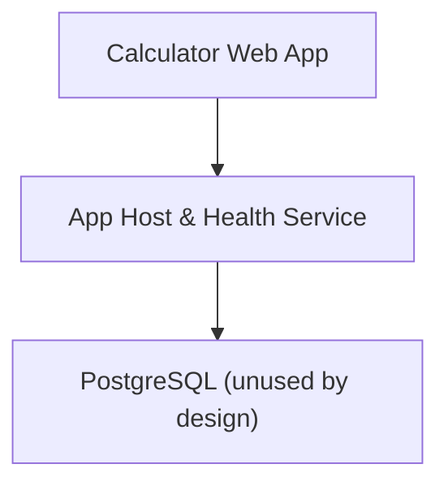
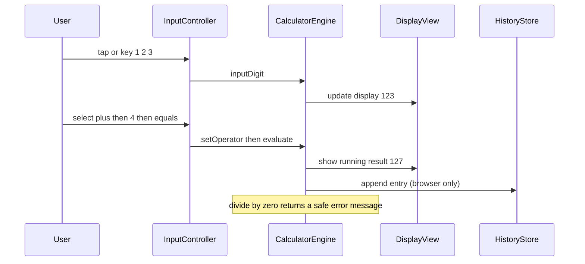
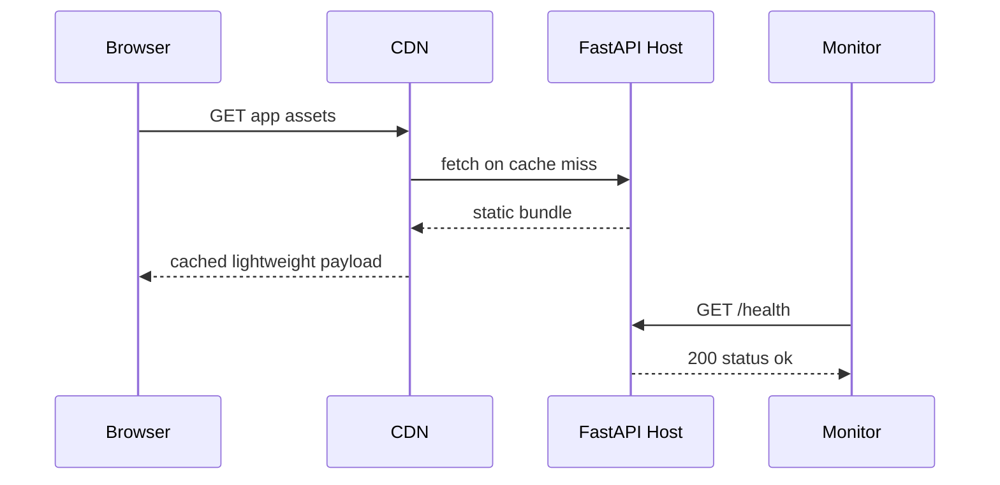
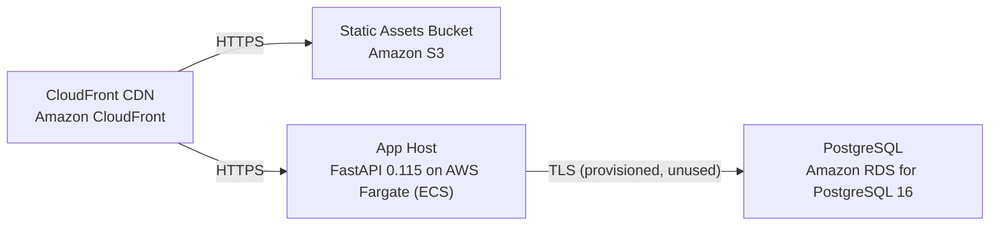

# Architecture

> Maintained by QuorQ AI SDLC. Text between `sdlc:auto` markers is regenerated; anything outside them is yours and is kept.

<!-- sdlc:auto:start narrative -->
## Overview

### ARCH-OVERVIEW · approved · source: architecture:summary

Overall architecture is a browser-only calculator: all arithmetic runs client-side in React 19, a FastAPI service only hosts static files and a health check, and PostgreSQL is provisioned but intentionally holds no user data.

Approved, version 1. Product is free and fully anonymous, targeted at Indian higher-education students and staff. Supported operations: add, subtract, multiply, divide, percentage, decimals, running result, clear/all-clear, driven by keyboard and on-screen input into one shared state. Optional calculation history lives only in the browser. FastAPI 0.115 hosts the static app and exposes a health endpoint so AWS can sustain availability through term-start and exam peaks, served from the AWS Mumbai region behind a CDN for low-bandwidth mobile access. PostgreSQL 16 is provisioned as the platform standard but stores no user data by design, which the architecture states keeps DPDP, parental-consent and CERT-In data obligations out of material scope. WCAG 2.1 AA / RPwD / GIGW accessibility is treated as a release gate.

- ⚠ No explicit mapping given from this architecture to any of the known requirement ids (US-001..US-014); traceability cannot be confirmed without that linkage.
- ⚠ Claim that 'no user data stored' keeps DPDP/CERT-In obligations out of scope is an architectural design intent, not a confirmed legal/compliance determination -- flagged for human legal review, not asserted as fact here.

### ARCH-COMP-FE · approved · source: architecture:components:frontend

Calculator Web App built in React 19, the sole place where arithmetic happens.

Renders the responsive, accessible calculator UI; handles all digit/operator/percentage/decimal entry from both on-screen buttons and keyboard; performs all arithmetic client-side; shows the running result and a divide-by-zero message; keeps optional calculation history in the browser only.

- ⚠ Not linked to a specific requirement id in the input.

### ARCH-COMP-BE · approved · source: architecture:components:backend

App Host & Health Service built on FastAPI 0.115, serves static assets and a health endpoint only.

Serves the built static React app and exposes a health/status endpoint so load balancing and monitoring can confirm availability during traffic peaks. Explicitly performs no calculation and stores no user data.

- ⚠ Not linked to a specific requirement id in the input.

### ARCH-COMP-DB · approved · source: architecture:components:database

PostgreSQL 16 is provisioned as the platform-standard database but is unused by design in this product.

Platform-standard relational database, provisioned for possible future server-side persistence. Holds no user data in this product, which the architecture states keeps personal-data obligations out of scope.

- ⚠ Not linked to a specific requirement id in the input.
- ⚠ Decision to leave the database unused is a design choice recorded here, not independently verified against any data-retention requirement.

### ARCH-CP-CALC · approved · source: architecture:critical_paths:Client-side calculation

Describes the end-to-end flow of a calculation entirely inside the browser, with no network call.

User enters numbers and operators via buttons or keyboard; the engine builds operands, applies the operator with defined decimal precision, handles divide-by-zero and percentage, updates the running result, and can clear (C) or reset (AC). No network request is made for this path.

- ⚠ Decimal precision rules are referenced as 'defined' but the specific precision value/behavior is not given in this input.

### ARCH-CP-DELIVERY · approved · source: architecture:critical_paths:App delivery and health

Describes how the app is delivered to the browser and kept available under load.

Browser requests the app; the CDN serves cached static assets or the FastAPI host returns them. Monitoring and the load balancer poll the health endpoint to keep the service available during peaks (term-start and exam periods).

### ARCH-EP-HEALTH · approved · source: architecture:endpoints:GET /health

Health/liveness endpoint used by infrastructure, not by end users.

GET /health is a liveness/readiness probe used by the load balancer and monitoring to confirm the app host is serving during term-start and exam peaks. Referenced against NFR-003 in the architecture input, though NFR-003 is not among the known requirement keys supplied for this project.

- ⚠ Architecture references 'NFR-003' but this id is not present in the known requirement key list (US-001..US-014); cannot confirm traceability.

### ARCH-EP-SPA · approved · source: architecture:endpoints:GET /{path:path}

Catch-all route serving the built single-page app.

GET /{path:path} serves the built React single-page app (index and static assets); unmatched routes fall back to index.html for client-side routing.

### ARCH-DEPLOY · approved · source: architecture:deployment_nodes

Deployment topology spans CloudFront, S3, Fargate-hosted FastAPI, and a managed PostgreSQL instance, all on AWS.

Nodes: CloudFront CDN (AWS global edge) for cached static delivery; Static Assets Bucket (Amazon S3) holding built frontend assets; App Host (FastAPI 0.115 on AWS Fargate/ECS, Python uvicorn container) serving the app and health endpoint; PostgreSQL (Amazon RDS for PostgreSQL 16) provisioned as platform standard but unused for user data. Served from the AWS Mumbai region for low latency to Indian users.

### ARCH-TECH-FE · approved · source: architecture:technology_decisions:Frontend

React 19 chosen for the frontend over Svelte and Vue.

Rationale: the entire product runs in the browser; React 19 gives a single responsive SPA and a mature accessibility ecosystem (ARIA, focus management, screen-reader labels) to meet the WCAG 2.1 AA / RPwD release gate, and keeps the payload light for low-bandwidth mobile use. Alternatives considered: Svelte, Vue.

### ARCH-TECH-BE · approved · source: architecture:technology_decisions:Backend

FastAPI 0.115 chosen for the backend over Flask and Starlette.

Rationale: the server's only job is to reliably serve the app and expose a health endpoint; FastAPI 0.115 is a light, dependable host that matches the platform default and stays healthy during peaks (referenced as NFR-003 in the input). Alternatives considered: Flask, Starlette.

- ⚠ References 'NFR-003' which is not in the known requirement key list supplied for this project.

### ARCH-TECH-DB · approved · source: architecture:technology_decisions:Database

PostgreSQL 16 chosen as the platform-standard database with no current alternative needed.

Rationale: provisioned as the platform standard for any future server-side persistence. No user data is written here, which the architecture states is precisely what keeps DPDP, parental-consent and CERT-In data duties out of material scope (referenced as NFR-009 in the input). No alternatives considered -- none needed for this product per the input.

- ⚠ References 'NFR-009' which is not in the known requirement key list supplied for this project.
- ⚠ The compliance-scope claim (DPDP/CERT-In out of scope) is a design rationale stated in the architecture, not a verified legal conclusion.

### ARCH-TECH-CLOUD · approved · source: architecture:technology_decisions:Cloud

AWS chosen as the cloud provider over Azure and GCP.

Rationale: AWS has the Mumbai region for low latency to Indian users and CloudFront for fast low-bandwidth delivery, and scales cheaply for a very light read-only app during registration and exam peaks. Alternatives considered: Azure, GCP.
<!-- sdlc:auto:end narrative -->

<!-- sdlc:auto:start building-blocks -->
## Building Block View

| ID | Name | Technology | Responsibility | Depends on |
|---|---|---|---|---|
| frontend | Calculator Web App | React 19 | Renders the responsive, accessible calculator UI, handles all digit/operator/percentage/decimal entry from both on-screen buttons and keyboard, performs all arithmetic client-side, shows the running result and divide-by-zero message, and keeps optional calculation history in the browser only. | backend |
| backend | App Host & Health Service | FastAPI 0.115 | Serves the built static React app and exposes a health/status endpoint so load balancing and monitoring can confirm availability during traffic peaks. Performs no calculation and stores no user data. | database |
| database | PostgreSQL (unused by design) | PostgreSQL 16 | Platform-standard relational database, provisioned for future server-side persistence. Holds no user data in this product, which keeps personal-data obligations out of scope. | — |

<!-- sdlc:auto:end building-blocks -->

<!-- sdlc:auto:start runtime -->
## Runtime View

### Client-side calculation

User enters numbers and operators via buttons or keyboard; the engine builds operands, applies the operator with defined decimal precision, handles divide-by-zero and percentage, updates the running result, and can clear (C) or reset (AC). No network request is made.

- **Components:** frontend
- **Modules:** CalculatorEngine, InputController, DisplayView, HistoryStore, KeyboardBindings
- **Key functions:** inputDigit(d), inputDecimal(), setOperator(op), applyPercentage(), evaluate(), clearEntry(), allClear(), formatResult(value, precision)

### App delivery and health

Browser requests the app; the CDN serves cached static assets or the FastAPI host returns them. Monitoring and the load balancer poll the health endpoint to keep the service available during peaks.

- **Components:** frontend, backend
- **Modules:** StaticFileRouter, HealthRouter
- **Key functions:** get_health(), serve_spa(path)

<!-- sdlc:auto:end runtime -->

<!-- sdlc:auto:start deployment-view -->
## Deployment View

| Name | Service | Runtime | Scaling | Environment |
|---|---|---|---|---|
| CloudFront CDN | Amazon CloudFront | AWS global edge | Edge-cached, auto-absorbs peaks | dev |
| Static Assets Bucket | Amazon S3 | AWS S3 | Managed, highly durable | dev |
| App Host | FastAPI 0.115 on AWS Fargate (ECS) | Python container (uvicorn) | Horizontal auto-scaling on CPU/requests for exam/registration peaks | dev |
| PostgreSQL | Amazon RDS for PostgreSQL 16 | Managed PostgreSQL 16 | Single small instance (unused by design) | dev |

| Source | Target | Protocol |
|---|---|---|
| CloudFront CDN | Static Assets Bucket | HTTPS |
| CloudFront CDN | App Host | HTTPS |
| App Host | PostgreSQL | TLS (provisioned, unused) |

<!-- sdlc:auto:end deployment-view -->

<!-- sdlc:auto:start decisions -->
## Architecture Decisions

| Layer | Choice | ADR |
|---|---|---|
| Frontend | React 19 | [ADR-0001](adr/frontend.md) |
| Backend | FastAPI 0.115 | [ADR-0002](adr/backend.md) |
| Database | PostgreSQL 16 | [ADR-0003](adr/database.md) |
| Cloud | AWS | [ADR-0004](adr/cloud.md) |
<!-- sdlc:auto:end decisions -->

<!-- sdlc:auto:start links -->
## Related Documents

- [Data Model](data-model.md)
- [API Specification](api/openapi.yaml)
- [Architecture Decision Records](adr/README.md)
<!-- sdlc:auto:end links -->
