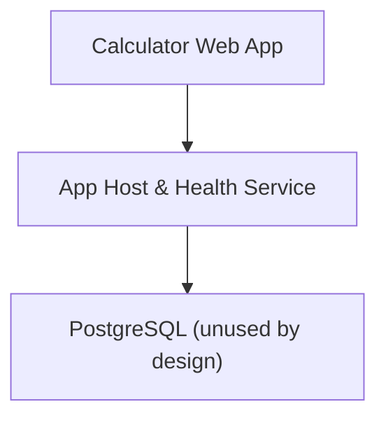
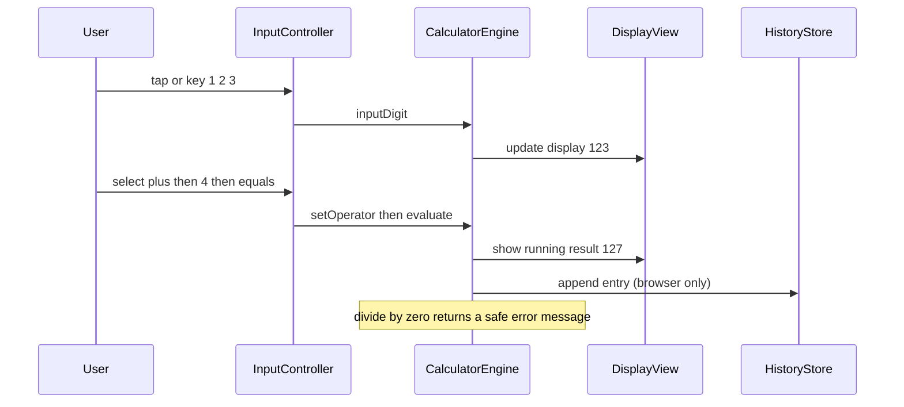
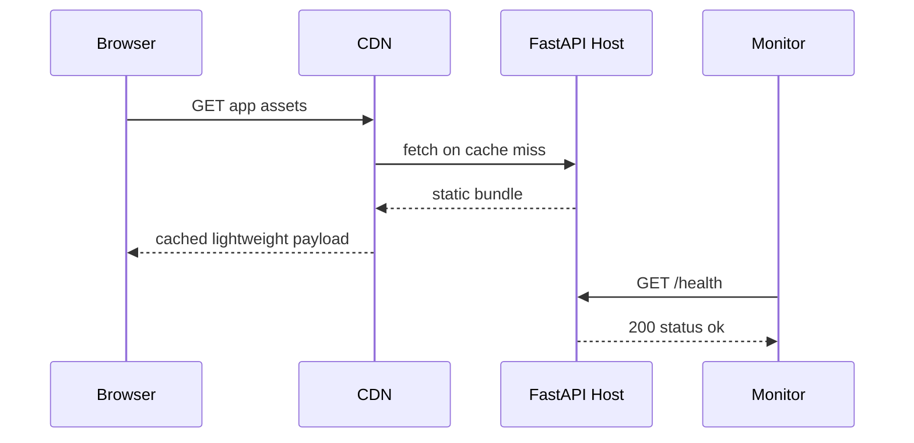
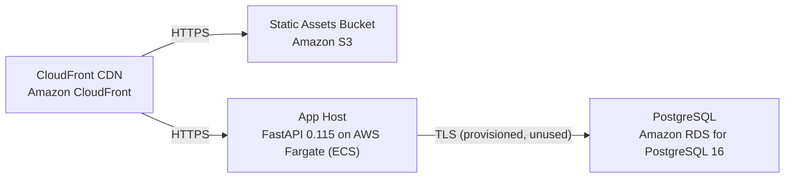

# Architecture

> Maintained by QuorQ AI SDLC. Text between `sdlc:auto` markers is regenerated; anything outside them is yours and is kept.

<!-- sdlc:auto:start narrative -->
## Overview

### AR-001 · approved · source: architecture:summary

Approved architecture (v1): a fully client-side React 19 SPA performs all arithmetic; a lightweight FastAPI 0.115 service hosts the static app and a health endpoint on AWS (Mumbai region + CDN) for peak-period availability; PostgreSQL 16 is provisioned but unused by design; WCAG 2.1 AA / RPwD / GIGW is a release gate.

Critical path 1 — Client-side calculation: user enters numbers/operators via buttons or keyboard; the engine builds operands, applies the operator at a defined decimal precision, handles divide-by-zero and percentage, updates the running result, and clears (C) or resets (AC); no network request is made.
Critical path 2 — App delivery and health: browser requests the app; CloudFront serves cached static assets or FastAPI returns them; monitoring and the load balancer poll the health endpoint to keep the service available during term-start/exam peaks.

**Related:** EPIC-001, EPIC-002, EPIC-003, EPIC-004, EPIC-005, EPIC-006, EPIC-007, NFR-003, NFR-006

### AR-002 · approved · source: architecture:component:frontend

Calculator Web App (React 19) renders the responsive, accessible UI and performs all logic client-side.

Handles all digit/operator/percentage/decimal entry from both on-screen buttons and keyboard; performs all arithmetic client-side; shows running result and divide-by-zero message; keeps optional calculation history in the browser only.

**Related:** EPIC-001, EPIC-002, EPIC-003, EPIC-006, EPIC-007

### AR-003 · approved · source: architecture:component:backend

App Host & Health Service (FastAPI 0.115) serves the built static React app and exposes a health/status endpoint.

Supports load balancing and monitoring to confirm availability during term-start/exam traffic peaks. Performs no calculation and stores no user data.

**Related:** NFR-003

### AR-004 · approved · source: architecture:component:database

PostgreSQL 16 is provisioned as the platform-standard database but is unused by design — holds no user data in this product.

Provisioned for potential future server-side persistence; in the current design it keeps personal-data/DPDP/parental-consent/CERT-In data obligations out of material scope by never writing user data.

**Related:** NFR-004, NFR-009, EPIC-005

- ⚠ Database is provisioned but intentionally idle; confirm there is no cost/governance objection to running a managed PostgreSQL instance that stores nothing.

### AR-005 · approved · source: architecture:endpoints

Two HTTP endpoints are exposed by the App Host.

- GET /health: liveness/readiness probe for the load balancer and monitoring to confirm the app is serving during peaks (NFR-003).
- GET /{path:path}: serves the built React SPA (index and static assets); unmatched routes fall back to index.html for client-side routing.

**Related:** NFR-003

### AR-006 · approved · source: architecture:deployment-nodes

Deployment topology: CloudFront CDN, S3 static-assets bucket, FastAPI on AWS Fargate (ECS/uvicorn), and Amazon RDS for PostgreSQL 16.

- CloudFront CDN (AWS global edge) for low-bandwidth, low-latency delivery.
- Static Assets Bucket (Amazon S3) for the built frontend.
- App Host (FastAPI 0.115 on AWS Fargate/ECS, Python/uvicorn container) serving the app and /health.
- PostgreSQL (Amazon RDS for PostgreSQL 16, managed) provisioned but unused.

**Related:** NFR-003, NFR-001

- ⚠ No logging/retention configuration is described for the Fargate/CloudFront/RDS nodes; CERT-In directions (India) require 180-day ICT log retention and 6-hour cyber-incident reporting, independent of whether personal data is processed — not addressed in the architecture input.

### AR-007 · approved · source: architecture:technology-decisions

Four stack decisions (React 19, FastAPI 0.115, PostgreSQL 16, AWS), each recorded with alternatives considered and rationale, matching the requirements-approved stack exactly.

- Frontend: React 19 (alternatives: Svelte, Vue) — single responsive SPA, mature accessibility ecosystem for the WCAG 2.1 AA / RPwD gate, light payload for low-bandwidth mobile.
- Backend: FastAPI 0.115 (alternatives: Flask, Starlette) — light, dependable host plus health endpoint for peak reliability (NFR-003).
- Database: PostgreSQL 16 (alternatives: none needed) — platform standard for future persistence; no user data written, keeping DPDP/parental-consent/CERT-In duties out of scope (NFR-009).
- Cloud: AWS (alternatives: Azure, GCP) — Mumbai region for low latency to Indian users, CloudFront for low-bandwidth delivery, cheap scaling for a light read-only app during peaks.

**Related:** REQ-TECH-STACK
<!-- sdlc:auto:end narrative -->

<!-- sdlc:auto:start building-blocks -->
## Building Block View

| ID | Name | Technology | Responsibility | Depends on |
|---|---|---|---|---|
| frontend | Calculator Web App | React 19 | Renders the responsive, accessible calculator UI, handles all digit/operator/percentage/decimal entry from both on-screen buttons and keyboard, performs all arithmetic client-side, shows the running result and divide-by-zero message, and keeps optional calculation history in the browser only. | backend |
| backend | App Host & Health Service | FastAPI 0.115 | Serves the built static React app and exposes a health/status endpoint so load balancing and monitoring can confirm availability during traffic peaks. Performs no calculation and stores no user data. | database |
| database | PostgreSQL (unused by design) | PostgreSQL 16 | Platform-standard relational database, provisioned for future server-side persistence. Holds no user data in this product, which keeps personal-data obligations out of scope. | — |

<!-- sdlc:auto:end building-blocks -->

<!-- sdlc:auto:start runtime -->
## Runtime View

### Client-side calculation

User enters numbers and operators via buttons or keyboard; the engine builds operands, applies the operator with defined decimal precision, handles divide-by-zero and percentage, updates the running result, and can clear (C) or reset (AC). No network request is made.

- **Components:** frontend
- **Modules:** CalculatorEngine, InputController, DisplayView, HistoryStore, KeyboardBindings
- **Key functions:** inputDigit(d), inputDecimal(), setOperator(op), applyPercentage(), evaluate(), clearEntry(), allClear(), formatResult(value, precision)

### App delivery and health

Browser requests the app; the CDN serves cached static assets or the FastAPI host returns them. Monitoring and the load balancer poll the health endpoint to keep the service available during peaks.

- **Components:** frontend, backend
- **Modules:** StaticFileRouter, HealthRouter
- **Key functions:** get_health(), serve_spa(path)

<!-- sdlc:auto:end runtime -->

<!-- sdlc:auto:start deployment-view -->
## Deployment View

| Name | Service | Runtime | Scaling | Environment |
|---|---|---|---|---|
| CloudFront CDN | Amazon CloudFront | AWS global edge | Edge-cached, auto-absorbs peaks | dev |
| Static Assets Bucket | Amazon S3 | AWS S3 | Managed, highly durable | dev |
| App Host | FastAPI 0.115 on AWS Fargate (ECS) | Python container (uvicorn) | Horizontal auto-scaling on CPU/requests for exam/registration peaks | dev |
| PostgreSQL | Amazon RDS for PostgreSQL 16 | Managed PostgreSQL 16 | Single small instance (unused by design) | dev |

| Source | Target | Protocol |
|---|---|---|
| CloudFront CDN | Static Assets Bucket | HTTPS |
| CloudFront CDN | App Host | HTTPS |
| App Host | PostgreSQL | TLS (provisioned, unused) |

<!-- sdlc:auto:end deployment-view -->

<!-- sdlc:auto:start decisions -->
## Architecture Decisions

| Layer | Choice | ADR |
|---|---|---|
| Frontend | React 19 | [ADR-0001](adr/frontend.md) |
| Backend | FastAPI 0.115 | [ADR-0002](adr/backend.md) |
| Database | PostgreSQL 16 | [ADR-0003](adr/database.md) |
| Cloud | AWS | [ADR-0004](adr/cloud.md) |
<!-- sdlc:auto:end decisions -->

<!-- sdlc:auto:start links -->
## Related Documents

- [Data Model](data-model.md)
- [API Specification](api/openapi.yaml)
- [Architecture Decision Records](adr/README.md)
<!-- sdlc:auto:end links -->
