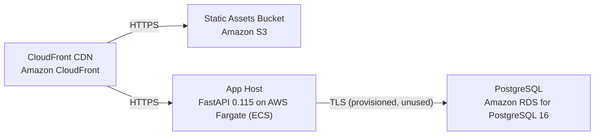

# Deployment Guide

> Maintained by QuorQ AI SDLC. Text between `sdlc:auto` markers is regenerated; anything outside them is yours and is kept.

<!-- sdlc:auto:start how-it-deploys -->
Pushes to `main` run `.github/workflows/deploy.yml`, which builds the API image (if there is a backend) and deploys the SPA to AWS Amplify. Commits touching only `docs/sdlc/**` don't deploy. Deployments can also be started from the platform's Deployment tab.
<!-- sdlc:auto:end how-it-deploys -->

<!-- sdlc:auto:start environments -->
| Name | Service | Runtime | Scaling | Environment |
|---|---|---|---|---|
| CloudFront CDN | Amazon CloudFront | AWS global edge | Edge-cached, auto-absorbs peaks | dev |
| Static Assets Bucket | Amazon S3 | AWS S3 | Managed, highly durable | dev |
| App Host | FastAPI 0.115 on AWS Fargate (ECS) | Python container (uvicorn) | Horizontal auto-scaling on CPU/requests for exam/registration peaks | dev |
| PostgreSQL | Amazon RDS for PostgreSQL 16 | Managed PostgreSQL 16 | Single small instance (unused by design) | dev |
<!-- sdlc:auto:end environments -->

<!-- sdlc:auto:start live -->
_Not deployed yet._
<!-- sdlc:auto:end live -->

<!-- sdlc:auto:start topology -->

<!-- sdlc:auto:end topology -->
